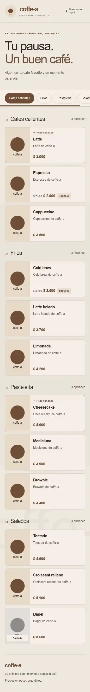
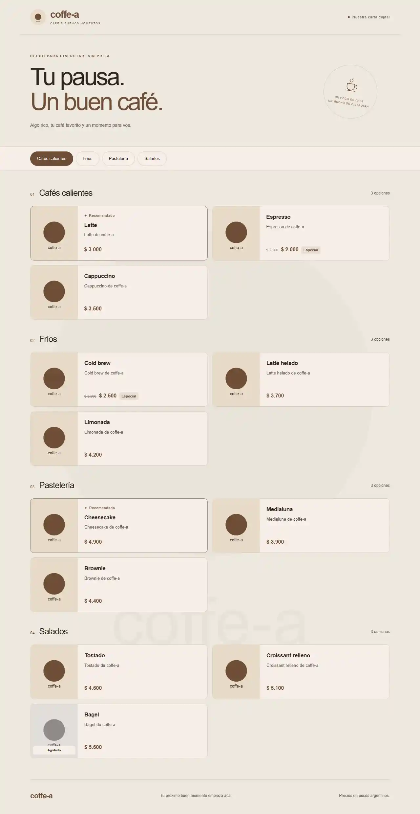

# Fase 1 — Menú público de coffe-a

El menú público reemplaza el stub de `/` y consume los contratos de F0 sin cambiar la capa de datos. Implementado en rama `f1-menu`, worktree `coffe-a-f1`, para integrar luego a `main`.

Documentación de base: [contratos de F0](../F0-CONTRACTS.md) y [puesta en marcha](../README.md).

## Qué incluye

- Header con logo configurable (`getTheme()`) y marca coffe-a.
- Carta agrupada por categoría; conserva destacados primero y el orden de F0.
- Chips sticky de 44 px, desplazamiento suave y categoría activa al recorrer la carta.
- Tarjetas con foto local (`next/image`, lazy y relación estable), nombre, descripción de dos líneas y precio ARS sin decimales.
- Precio original tachado, promo y etiqueta; badge Recomendado y estado Agotado.
- Fondo de `getBackground()` renderizado por el componente existente. Una capa del color secundario protege la lectura sobre imágenes; F3 completará los demás tipos de fondo.
- Estado de menú vacío y exclusión de grupos vacíos.
- Entrada sutil de tarjetas y respeto de `prefers-reduced-motion`; contenido visible sin JavaScript.
- Colores y tipografía derivados de variables CSS del tema, sin modificar estilos globales.

## Componentes y props

| Componente | Props | Ejecución |
| --- | --- | --- |
| `CategoryTabs` | `categories: { id: string; nombre: string }[]` | Cliente: navegación, scroll y chip activo |
| `ProductCard` | `product: Product` | Servidor: foto, descripción, precio y estados |
| `PromoBadge` | `label: string` | Servidor: etiqueta promocional |
| `Reveal` | `children: ReactNode` | Cliente: IntersectionObserver para animación |
| `CoffeeMark` | Sin props | Servidor: ícono SVG decorativo |

Estilos encapsulados en `components/menu/menu.module.css`. `app/page.tsx` permanece como Server Component y usa `listByCategory()`, `getTheme()` y `getBackground()`. La ruta es dinámica: una recarga lee los datos actuales. F2 debe ejecutar `revalidatePath('/')` tras guardar, como establece el plan.

## Vista

A 375 px: header compacto, introducción, carril horizontal de categorías y tarjetas en una columna con imagen a la izquierda. A 1280 px: contenido centrado de hasta 1160 px, sello decorativo y tarjetas en dos columnas. Las secciones se numeran y muestran cantidad de opciones. El seed conserva imágenes placeholder de F0; las fotos reales corresponden al catálogo de F4.

## Contratos y alcance

No se necesitan funciones nuevas en `lib/data/`. `listByCategory()` ya incluye no disponibles, que se muestran como Agotado. La marca se llama coffe-a porque `Theme` expone logo pero no nombre comercial. Admin, autenticación, pedidos, carrito y buscador quedan fuera de esta fase.

La carpeta `docs/` se agrega por pedido explícito del usuario, además de los archivos autorizados por el alcance de F1.

## Verificación

- `npm run build`: aprobado sin advertencias de compilación ni errores de tipos.
- Smoke HTTP en producción: 12 productos y 4 categorías del seed; menú vacío; producto con promo, recomendado y agotado; actualización de precio/disponibilidad visible al recargar. Las mutaciones se hicieron en `data/verify.db`, separada de la demo.
- Revisión visual de capturas completas a 375 px y 1280 px. Sin desbordes visibles en la página; el carril de categorías tiene scroll horizontal intencional.
- Lighthouse 12.8.2 sobre producción en Chrome headless. Reportes completos: [móvil](reports/lighthouse-mobile.report.html) y [escritorio](reports/lighthouse-desktop.report.html).
- Auditoría móvil final: Performance **85/100**, Accessibility **100/100**, Best Practices **100/100**, SEO **100/100**. Cumple el mínimo móvil ≥ 85. FCP 1,01 s; LCP 2,24 s; TBT 526 ms; CLS 0.
- Auditoría de escritorio (preset desktop, 1280 px): Performance **100/100**, Accessibility **100/100**, Best Practices **100/100**, SEO **100/100**.
- El reporte final no registra errores de consola. Se resolvió el favicon faltante dentro de `app/page.tsx`.

Las puntuaciones son mediciones locales con throttling de Lighthouse y dependen de la carga del equipo. No hubo navegador conectado a la herramienta de revisión interactiva: la revisión visual usa las capturas de Lighthouse; no se afirma una prueba de clics automatizada de los chips ni una prueba en un teléfono físico. El scroll activo y movimiento reducido están implementados, con enlaces nativos como fallback sin JS.

## Cómo levantarlo

Desde `coffe-a/`, con las dependencias de F0 instaladas:

```powershell
npm run db:push
npm run seed
npm run dev
```

Abrir http://localhost:3000. El seed reemplaza productos y marca con los datos dummy. Para verificar rendimiento usar producción: `npm run build` y `npm start`.

## Evidencias visuales

Capturas completas generadas por Lighthouse sobre la versión de producción:

### Móvil · 375 px



### Escritorio · 1280 px


