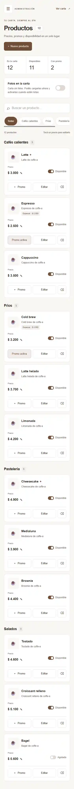
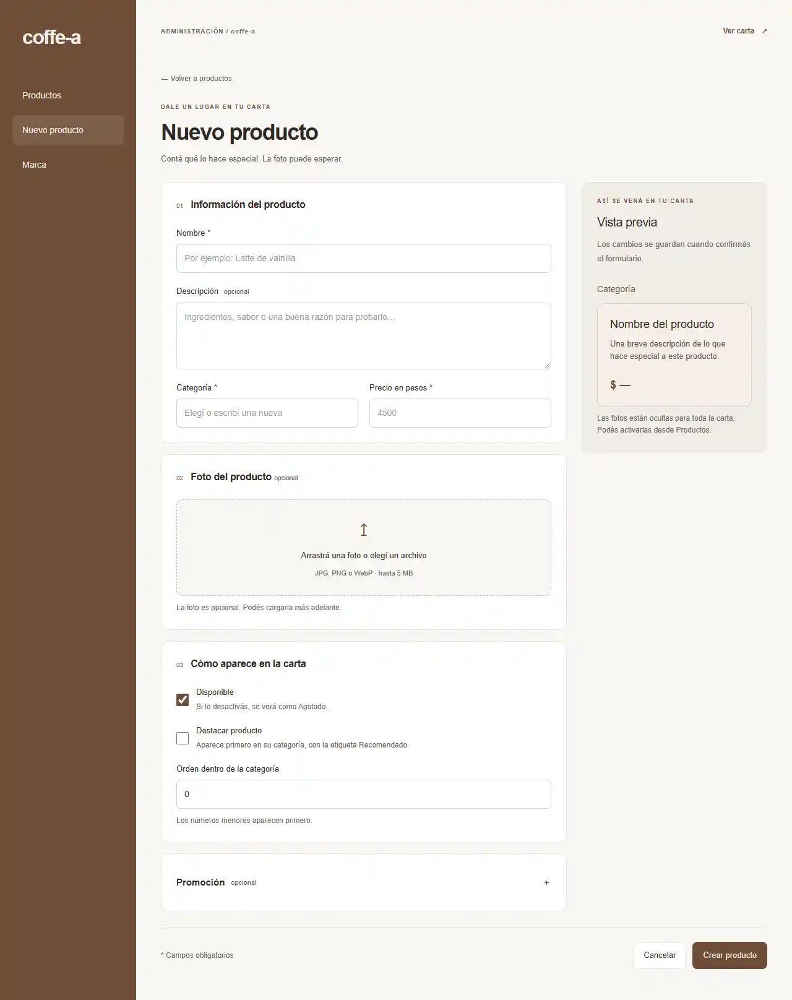

# Fase 2 — Administración de productos

Implementada en rama `f2-admin`, worktree `coffe-a-f2`, sobre F0/F1. Permite mantener la carta desde el celular y cargar productos desde una PC, incluso sin fotos.

## Uso

- `/admin`: listado por categoría; búsqueda por nombre sin distinguir tildes; filtros; precio editable (Enter guarda, Esc cancela); disponibilidad; promos; edición y eliminación con confirmación.
- `/admin/productos/nuevo`: alta con categoría existente o nueva, descripción, precio, foto opcional, destacado, disponibilidad, orden y promo.
- `/admin/productos/[id]`: mismo formulario con valores actuales y estado de producto inexistente.
- Vista previa en vivo propia de admin, con dos columnas desde 1024 px.
- Toasts y validación compartida con Zod; Server Actions revalidan `/` y `/admin`.
- Listado en cards por debajo de 1200 px, controles de al menos 44 px, navegación colapsable debajo de 768 px y promociones en bottom sheet móvil.

## Fotos opcionales

En `/admin`, **Fotos en la carta** activa o desactiva todas las fotos. Está apagado por defecto mientras se prepara el material. Ocultar fotos no borra archivos ni referencias. Al activarlo solo aparecen imágenes reales cargadas; los productos sin foto usan una tarjeta de texto. Agotado y Recomendado siguen visibles.

La foto del formulario es opcional. Se conserva `/placeholder.svg` como valor interno para productos sin foto, respetando el contrato de producto de F0. **Quitar foto de este producto** desvincula su imagen al guardar. Se puede volver a cargar más adelante. No hay un nuevo campo en la tabla products.

## Upload

`POST /api/upload`: multipart con campo `file`; respuesta 201 `{ path: "/uploads/<uuid>.webp" }`. Admite JPG/PNG/WebP de hasta 5 MB; valida el contenido con Sharp, limita dimensiones de entrada, corrige orientación y guarda WebP de hasta 1600 px, sin metadatos originales. Rechaza tipos falsos, archivos inválidos y solicitudes de otro origen.

`GET /uploads/[filename]` sirve archivos nuevos sin reiniciar producción. Es necesario porque Next.js enumera `public/` al arrancar y una foto subida más tarde daba 404. Solo admite nombres UUID y extensiones de imagen conocidas, sin rutas arbitrarias. Los archivos permanecen en `public/uploads/`.

## Extensión de contratos pedida por el usuario

Se agrega `lib/data/menu-display.ts`, sin modificar los contratos existentes:

```ts
type MenuDisplay = { showProductImages: boolean }
getMenuDisplay(): MenuDisplay
setMenuDisplay(input: MenuDisplay): MenuDisplay
// defaultMenuDisplay = { showProductImages: false }
```

Se persiste como JSON en settings, clave `menu_display`. No requiere migrar la base. `app/page.tsx` pasa la preferencia a `ProductCard`, cuyo prop nuevo `showImage?: boolean` es opcional. El cambio en el menú, la nueva capa de settings y la ruta de lectura de uploads extienden el alcance original de F2 para cumplir el pedido de fotos opcionales y permitir uploads en producción. No se modifica `app/admin/layout.tsx`, `app/layout.tsx`, el esquema de producto ni sus funciones de datos.

`sharp` se declara como dependencia directa. Se amplía `scripts/test-data.ts` para cubrir defaults y persistencia del nuevo setting.

## Componentes

`AdminShell` (navegación móvil y toasts), `ProductList`, `PriceInlineEdit`, `PromoEditor`, `Modal`, `ProductForm`, `ImageUpload` y `ProductPreview`. Estilos encapsulados en `components/admin/admin.module.css`; los ajustes del layout de F0 se aplican con selectores limitados a estas páginas.

## Datos reales y fondos

El Excel y los diseños de fondo no se encontraron entre los archivos del proyecto. Su incorporación está pendiente de que el usuario indique sus rutas. No se importaron datos ni se sustituyeron los productos de demo. Los fondos y personalización de marca corresponden a F3; `/admin/marca` sigue como stub de esa fase.

## Verificación

- `npm test`: funciones de datos existentes, validación y persistencia del control de fotos, en SQLite temporal.
- Smoke HTTP de Server Actions y upload, sin mocks: alta sin foto, edición, precio, promo, disponibilidad, borrado, errores de validación, límites de upload y fotos on/off en la carta. Limpia su producto/imagen temporal y restaura el setting.
- `npm run build`: aprobado, sin errores de tipos ni advertencias de compilación.
- Listado móvil a 375 px: Lighthouse Performance 99/100; Accessibility, Best Practices y SEO 100/100.
- Formulario desktop a 1280 px: Performance, Accessibility, Best Practices y SEO 100/100.
- Ambas auditorías sin errores de consola. Capturas revisadas, sin desbordes visibles. Resumen de métricas en [f2-resumen.json](reports/f2-resumen.json).

Para repetir el smoke, arrancar una instancia de producción con una base de prueba. El script y el servidor deben compartir `DATABASE_PATH` y la misma compilación:

```powershell
$env:DATABASE_PATH = 'data/f2-test.db'
npm run db:push
npm run seed
npm run build
npm.cmd run start -- -p 3003 --hostname 127.0.0.1
# En otra terminal, misma carpeta y DATABASE_PATH:
$env:DATABASE_PATH = 'data/f2-test.db'
$env:ADMIN_TEST_ALLOW_MUTATIONS = '1'
$env:ADMIN_TEST_BASE_URL = 'http://127.0.0.1:3003'
node --import tsx components/admin/__tests__/admin-smoke.mjs
```

Las pruebas HTTP comprueban persistencia y render de servidor; no equivalen a clics de navegador. El entorno no cuenta con navegador interactivo conectado, por lo que la revisión visual usa capturas de Lighthouse.

## Capturas

### Listado móvil · 375 px



### Formulario desktop · 1280 px


